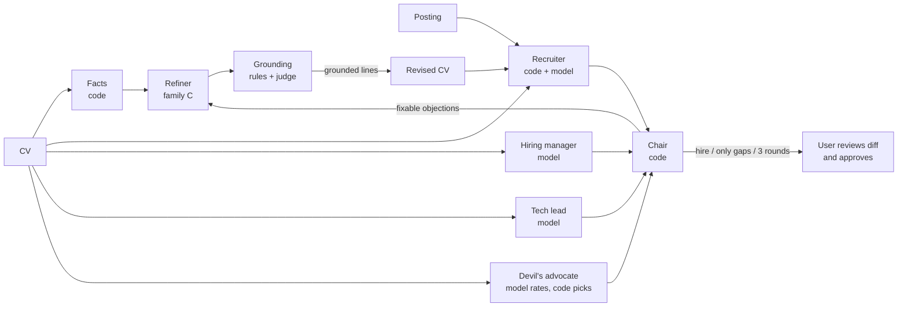

# Hiring Committee Simulator

A panel of local LLM agents reviews a CV against a real job posting the way a hiring team would.
The panel is a recruiter, a hiring manager, a tech lead and a devil's advocate, and a chair decides.
A refiner then improves the CV's presentation using only the candidate's own facts. Every rewritten
line has to pass a grounding check before it reaches the CV.

It runs entirely on a laptop GPU (RTX 3060, 6 GB) through Ollama. The one exception is a held-out
judge on an API (Groq), used only for evaluation.

The interesting part is not the agents but how they were measured. Every prompt and checklist
change was tested on labelled CVs. The answer keys and success criteria were committed **before**
each run, so the git history shows nothing was tuned after the fact.



## Design in one paragraph

**Models judge, code decides.** Each reviewer answers a checklist of yes/no checks. For every check
it must quote the CV before giving its verdict. Code then does the rest:
- it fails any pass whose quote isn't really in the CV;
- it computes the score (must-haves weigh 3, nice-to-haves 1);
- it caps the decision when a must-have fails;
- the chair turns the members' decisions into a verdict.

What code can compute, code computes: years of experience, keywords, title, line length, the facts,
and the numbers and names in a claim. No model ever gives a gut score.

## Results

The 30 labelled CVs, 2 postings and all answer keys are synthetic: written for this project, never
real people. Small sets give rough signals: at 30 cases, ±16 points.

| What | Result | Target (pre-registered) |
|---|---|---|
| Tech lead (qwen2.5:7b), decisions on 30 CVs | 28/30 (11/11 on the cases it was tuned on, 17/19 on the rest) | no regression |
| Second judge family (llama3.1:8b) | 14/19 on unseen CVs | ≥ 17/19 — **not met**, judge B open |
| Committee verdict vs labels | **29/30**, 0 failed calls, 63 s per session | ≥ 23/30 |
| Leniency (hire on a poor CV) | 0/3 | 0 |
| Grounding judge, qwen2.5:7b local, held-out claims | 7/12, 1 lenient | ≥ 10/12, ≤ 1 lenient: **not met** |
| Grounding judge, qwen3.8-27b on Groq, same prompt | **12/12**, 0 lenient (with 3 format retries) | met, so it runs in the loop |
| Refinement: poor CVs still no_hire / borderline turned into hire | 5/5 / 0/13 | all / none |
| Refinement: good CVs that lost their hire | 0 | none |
| Refinement: recruiter score rose on refined CVs | 10/17 (59%) | ≥ 70%: **not met** (an oscillation bug, below) |
| Refinement: kept lines a manual read finds unsupported | 1 of 26 (employer numbers framed as the candidate's) | 0: **not met** |
| Held-out gap: the API judge's recruiter score rose where the loop's did | 8/10 | ≥ 70% |
| Held-out gap: the API tech lead's decision unchanged on refined borderline and poor CVs | 5/6 (one moved strong_no → lean_no, towards its key, not to a hire) | all: **not met** by the letter |

The refinement row took three rounds:
- **v1** put the summary above the job title, which hid the title from the title check.
- **v2** let the 7B refiner choose the facts. It picked titles and vague bullets.
- **v3** moved fact choice and triage into code. Each round now rebuilds the summary from that
  round's failures only, so a fix from round 2 can be lost in round 3. The fix (keep earlier lines)
  is known but was not applied, because v3 was agreed as the last round before it ran.

The other members (hiring manager, tech lead, devil's advocate) judge the experience section, which
the refiner never touches, so refinement cannot move the verdict. That is by design: a rewrite that
looks better should not make a candidate look more qualified.

Phase 0 compared four local 7–8B families as the tech lead. Only qwen2.5:7b passed the gate,
getting every decision right with checklist v3. A local gemma3:12b judged well but took 206 s per
review, so the held-out judge moved to `openai/gpt-oss-120b` on Groq.

### What went wrong, and what it taught

- **Form over meaning.** Small models pass a check when the CV has *something that looks like it*:
  - Python scripts passed as backend services;
  - the employer's user count passed as the candidate's result;
  - buzzwords passed as a description of the work.

  Checks now say what doesn't count.
- **Change what the model sees before what it's told.** Telling the recruiter "a job title alone
  doesn't count" made it quote job titles more often. Removing the dated title lines from its input
  fixed it.
- **Position bias.** Asked for "the three strongest objections", the devil's advocate returned the
  posting's first three requirements in order, 24 times out of 24. Now it rates every requirement
  and code picks.
- **The strict–lenient swing.** Rewording the 7B grounding judge to stop it rejecting true
  paraphrases made it accept inflated claims (lenient errors 1 → 3 of 12). Wording that only moves
  errors from side to side points at the model's limit. The same prompt on a 27B model fixed it.
- **Measure, then move only what needs it.** Only the grounding judge went to an API. The
  refiner's problems were design problems, which a bigger model wouldn't have fixed.
- **Check that a metric can fail.** One devil's-advocate metric was met by almost every CV, good
  ones included, so it measured nothing.

The full journal of decisions is in the commit messages. Each experiment's criteria sit in the
commit before its run.

## Run it

You need Python 3.12 and [Ollama](https://ollama.com). Pull the models first:
- `qwen2.5:7b` for the judges;
- `mistral:7b` for the refiner.

The grounding judge and the held-out judge run on Groq: put a key in `.env` (see `.env.example`).
Only synthetic CVs go there.

```bash
python -m venv .venv && .venv/Scripts/activate      # Windows; source .venv/bin/activate elsewhere
python -m pip install -r requirements-dev.txt
pytest                                              # no model needed
```

The evaluation scripts need Ollama running (`ollama serve`):

```bash
python -m hcs.run_eval --agent tech_lead          # one reviewer on every labelled CV
python -m hcs.run_committee --transcript          # the whole committee, with meeting transcripts
python -m hcs.run_grounding                       # the grounding judge on labelled claims
python -m hcs.run_refinement                      # refinement sessions on every labelled CV
python -m hcs.session my_cv.txt --posting backend_payments   # your own plain-text CV
python -m hcs.tracing                             # cost and latency per agent, from the run log
```

The held-out judge needs a Groq key in `.env` (see `.env.example`):

```bash
python -m hcs.run_held_out
```

## Layout

| Path | What |
|---|---|
| `hcs/agents/` | One file per agent: prompt, model settings, message builder |
| `hcs/pipeline.py` | One review: call, policies, score, decision, log |
| `hcs/policies.py` | Evidence policy, truth check, scoring, the must-have gate |
| `hcs/screening.py` | The recruiter's code checks |
| `hcs/chair.py`, `hcs/committee.py` | The verdict rule and one committee round |
| `hcs/profile.py`, `hcs/grounding.py` | Facts and the grounding rules |
| `hcs/refinement.py` | The refinement loop |
| `hcs/evaluation.py` | Comparing runs with answer keys |
| `data/postings/`, `data/checklists/`, `data/cases/` | Postings, reviewed checklists, labelled CVs with keys |
| `runs/` | The run log (every call, replayable) and traces; not committed |

## Limitations

- The answer keys were written by the same author as the prompts, and most of the later ones have
  not had a second reader.
- The sets are small: 38 CVs and 34 claims.
- Only one model family passed as a judge. The members differ in what they see and check, not in
  model family.
- Refinement results across runs are not exactly repeatable. Groq doesn't guarantee seeds, and one
  local committee verdict changed between two runs at temperature 0.
- The refiner only writes a summary at the top of the CV. Real CVs need more, but a whole-CV rewrite
  gives a 7B model room to invent.
- These parts of the design are not built yet:
  - the company researcher (each posting has a hand-written brief);
  - CV parsing from PDF;
  - logging real outcomes;
  - a UI.
